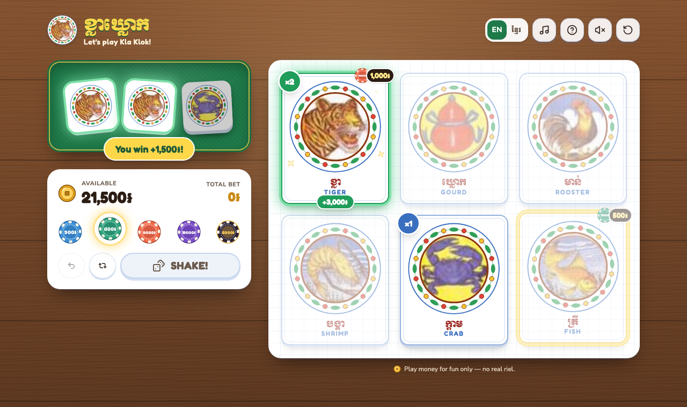
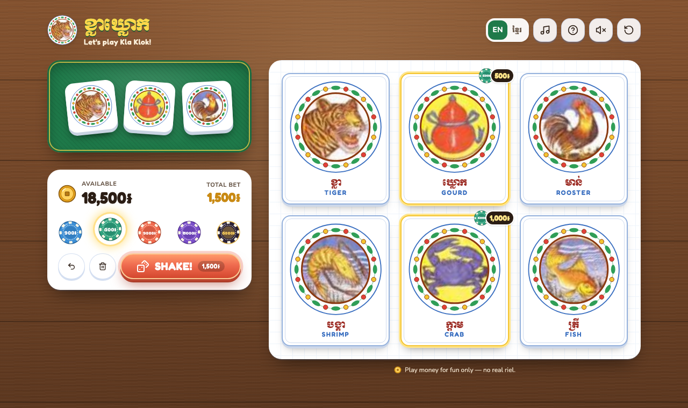
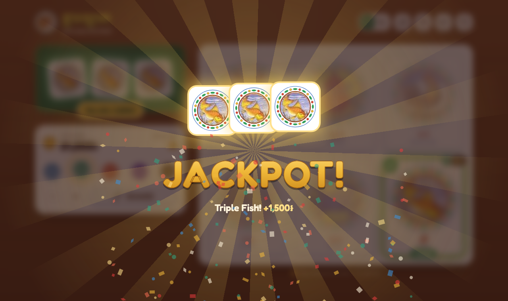
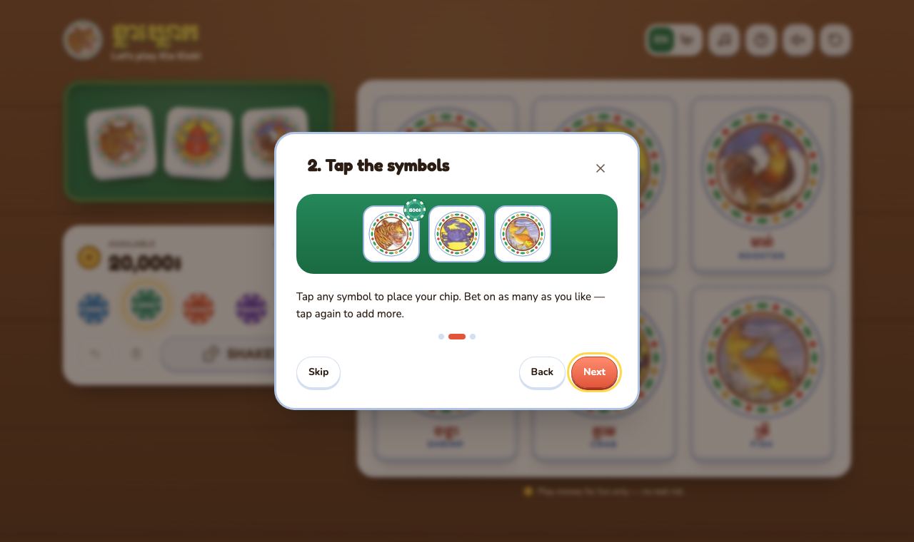
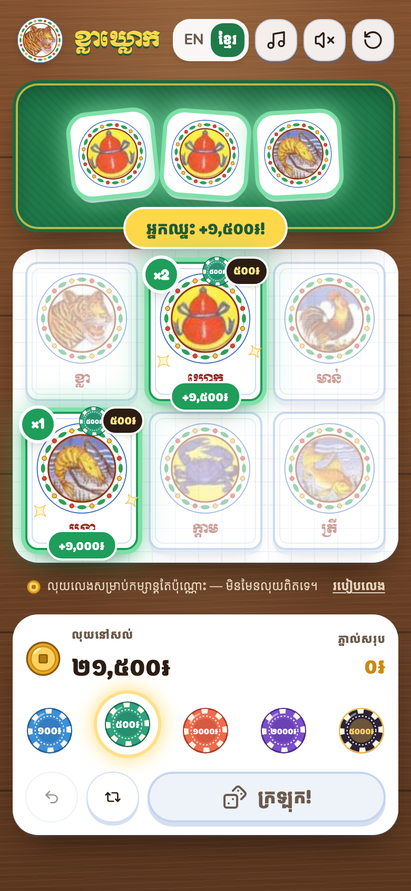

# Kla Klok · ខ្លាឃ្លោក

A web version of **Kla Klok** (ខ្លាឃ្លោក, "Tiger-Gourd"), the traditional Cambodian dice game
played at Khmer New Year and festivals.

> **For fun only.** The game uses play money (riel ៛). There is no real money, payments,
> accounts, backend, or tracking. Everything runs in your browser.



---

## Screenshots

<table>
  <tr>
    <td width="62%" valign="top">
      <br>
      <b>Placing bets</b>: pick a chip and tap the symbols. The SHAKE button shows your total.
      <br><br>
      <br>
      <b>Jackpot</b>: all three dice match a symbol you bet on.
      <br><br>
      <br>
      <b>Tutorial</b>: a short 3-step guide the first time you play.
    </td>
    <td width="38%" valign="top">
      <br>
      <b>On a phone, in Khmer</b>: dice, then the mat, with the controls fixed at the bottom.
      Amounts use Khmer digits.
    </td>
  </tr>
</table>

---

## Quick start

You need [Node.js](https://nodejs.org) 18 or newer.

```bash
npm install
npm run dev
```

Then open **http://localhost:5173**.

| Command           | What it does                                          |
| ----------------- | ----------------------------------------------------- |
| `npm run dev`     | Start the game for development (auto-reloads)          |
| `npm run build`   | Type-check and build the production site into `dist/`  |
| `npm run preview` | Serve the production build at http://localhost:4173    |
| `npm test`        | Run the game-logic unit tests                          |

---

## How to play

1. **Pick a chip:** ១០០៛, ៥០០៛, ១,០០០៛, ២,០០០៛ or ៥,០០០៛.
2. **Tap a symbol** to place the chip on it: Tiger, Gourd, Rooster, Shrimp, Crab or Fish.
   You can bet on several symbols, and tapping a symbol again adds another chip.
3. **Press SHAKE!** Three dice roll, and each one shows a symbol.

You start with **20,000៛**.

| Dice showing your symbol | You get back                    |
| ------------------------ | ------------------------------- |
| 0                        | Nothing (bet lost)              |
| 1                        | Your bet + 1× profit            |
| 2                        | Your bet + 2× profit            |
| 3                        | Your bet + 3× profit: JACKPOT 🎉 |

**Example:** 1,000៛ on Tiger, and the dice show Tiger · Tiger · Fish. You get 3,000៛ back
(your 1,000៛ + 2,000៛ profit).

### របៀបលេង (Khmer)

1. ជ្រើសរើសឈីប: ១០០៛ ៥០០៛ ១,០០០៛ ២,០០០៛ ឬ ៥,០០០៛
2. ចុចលើរូប (ខ្លា ឃ្លោក មាន់ បង្គា ក្ដាម ត្រី) ដើម្បីភ្នាល់ អាចភ្នាល់បានច្រើនរូប
3. ចុច **ក្រឡុក!** គ្រាប់ឡុកឡាក់នីមួយៗដែលចេញរូបរបស់អ្នក គឺឈ្នះ

### Controls

| Control              | Action                                                           |
| -------------------- | ---------------------------------------------------------------- |
| ↶ Undo               | Remove the last chip you placed                                  |
| 🗑 Clear              | Remove all bets (becomes **↻ Rebet** after a round)              |
| ↻ Rebet              | Place the same bets as last round                                |
| EN / ខ្មែរ            | Switch language                                                  |
| 🎵                    | Background music on/off                                          |
| 🔊                    | Game sound effects on/off                                        |
| ⟲                    | Restart with a fresh 20,000៛ (asks to confirm)                   |
| ?                    | How to play                                                      |

**Keyboard:** `1`–`6` bet on a symbol · `S` shake · `U` undo

If you run out of money, the game offers a fresh start.

---

## Features

- Traditional Kla Klok mat design with the six classic illustrations
- Animated dice that shake, bounce and land one by one
- Winning tiles light up, with sparkles, coins flying to your balance, and confetti for big wins
- Full-screen jackpot celebration when all three dice match a symbol you bet on
- Sound effects made in the browser, plus a looping background song
- English and Khmer, with amounts in riel (Khmer digits in Khmer mode)
- Works on phones and desktops: two columns on desktop; on phones the dice, then the mat, then a control bar fixed to the bottom
- Saves your balance and settings in the browser (`localStorage`)
- First-time tutorial, keyboard shortcuts, screen-reader labels and reduced-motion support
- Dice are fair: each die is rolled with the browser's secure random number generator

---

## Customising

| What                      | Where                                                                |
| ------------------------- | -------------------------------------------------------------------- |
| Background song           | Replace `public/song.App.mp3` (keep the file name)                   |
| Symbol pictures           | Replace the six PNGs in `src/assets/symbols/` (same names, square, transparent outside the circle) |
| Starting money / chips    | `STARTING_BALANCE` and `CHIP_VALUES` in `src/game/types.ts`          |
| Chip colours              | `CHIP_COLORS` in `src/components/art/Ornaments.tsx`                  |
| Text (English and Khmer)  | `src/i18n/strings.ts`                                                |
| Music volume              | `useBackgroundMusic(settings.music)` in `src/App.tsx` (2nd argument, default `0.35`) |

If you change chip values, give each new value a colour in `CHIP_COLORS`.

---

## Deploying

`npm run build` creates a static site in `dist/`. Upload that folder to any static host
(Netlify, Vercel, GitHub Pages, Cloudflare Pages, or a plain web server).
If the site lives in a sub-folder (for example `https://example.com/kla-klok/`), set
`base: '/kla-klok/'` in `vite.config.ts` before building.

---

## Troubleshooting

- **Music doesn't play right away.** Browsers block sound until you interact with the page,
  so the song starts on your first tap or key press. Check that 🎵 is on (green).
- **Music stops when I switch tabs.** This is on purpose. It resumes when you come back.
- **Start completely fresh.** Use ⟲ Restart, or clear the site data in your browser.
  The saved keys are `klaklok:game:v2` and `klaklok:settings:v1`.
- **Fonts look plain offline.** Fonts load from Google Fonts. Without internet, the game falls
  back to system fonts and still works.

---

## Project structure

```
docs/screenshots/     images used in this README
public/
  song.App.mp3        background music
  favicon.svg
src/
  game/               game rules (no UI code)
    types.ts            symbols, chips, starting balance, state types
    rules.ts            payouts and settlement
    reducer.ts          bet / undo / clear / rebet / roll / settle / restart
    random.ts           fair dice (crypto random)
    storage.ts          saving to localStorage
    rules.test.ts       unit tests
  audio/
    sound.ts            sound effects (Web Audio)
    useBackgroundMusic.ts  looping background song
  i18n/strings.ts     English + Khmer text, riel formatting
  assets/symbols/     the six symbol pictures
  components/
    art/                medallions, chips, coin icon
    effects/            confetti, flying coins, jackpot, toast
    modals/             tutorial, how-to-play, confirm dialogs
    DiceTray.tsx        dice panel and animation
    SymbolTile.tsx      board tiles
    Controls.tsx        balance, chips, undo/clear, shake
    Header.tsx          title, language, music, sound, restart
  App.tsx             puts it all together
```

**Built with:** React 18, TypeScript, Vite, Tailwind CSS 4, Motion, Lucide icons.

---

## Credits

- The symbol pictures come from a Kla Klok mat poster, and the background song was supplied
  by the project owner. Both belong to their creators. Get permission before publishing or
  sharing the game publicly.
- Fonts: Fredoka, Nunito, Kantumruy Pro and Moul (Google Fonts).
